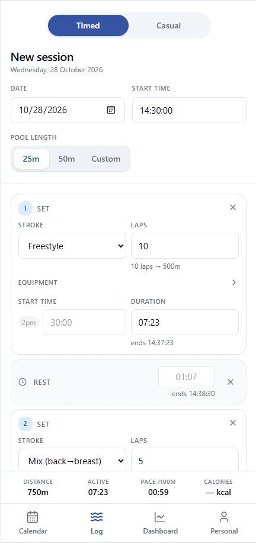
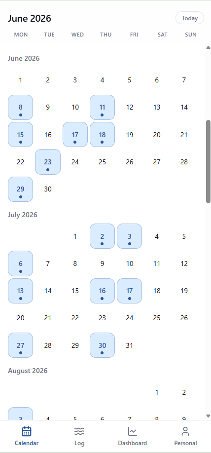
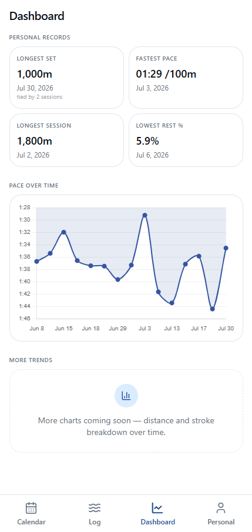

# swimlog

A swim tracking app for the pool, built as a mobile-first PWA that can be added to the iOS home screen.

## Screenshots

  
  
  

Log a session (left), see which days you swam (middle), track records and pace over time (right).

## What it does

- Log sessions and sets with stroke type, laps, equipment and rest periods
- Wall-clock timing: set and rest times cascade forward from the start, with manual overrides
- Calorie estimates based on MET values, plus weight tracking
- Personal records board and pace charts
- Scrollable calendar with session type indicators
- Repeat or copy a previous session
- Shareable square session card, exported as a PNG
- Email and password sign-in

One lap is counted as 50 m (there and back in a 25 m pool).

## Stack

- React and TypeScript with TanStack Start, built with Lovable
- Tailwind CSS
- Supabase for Postgres, auth and row-level security
- PWA manifest for home screen install

## Run it yourself

You need your own Supabase project. This repo contains no credentials.

1. Install dependencies: `bun install` (or `npm install`)
2. Copy `.env.example` to `.env` and fill in the URL and publishable key from your Supabase project
3. Create the tables the app reads and writes: `sessions`, `sets`, `user_profile` and `weight_log` (column types are in `src/lib/swim-types.ts` and `src/lib/user-profile.ts`), and enable row-level security so each user only sees their own rows
4. Start the dev server: `bun run dev`

## Status

Personal project in active development. Planned: Spotify integration, Oura Ring HRV overlay, and Apple Health via Capacitor.
